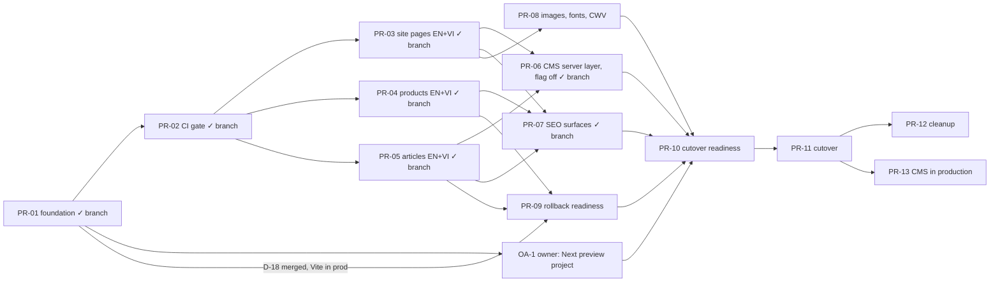

# Migration Roadmap: Vite SPA to Next.js App Router

| | |
|---|---|
| Status | Revision 7, 2026-11-09. PR-01 to PR-08 are implemented on `feat/nextjs-foundation` (not merged; D-18 not approved). Fonts stay on Google Fonts (D-20). Production runs Vite with `CMS_CONTENT` off. No cutover, and no CMS in production. Test and CI numbers: [architecture §12](NEXTJS_TARGET_ARCHITECTURE.md#12-coexistence-evidence-branch-featnextjs-foundation). |
| Remaining estimate | About 7 engineer-days (1.5 weeks for one engineer; 2–3 calendar weeks with review), plus owner and content actions |
| Related | [Audit](NEXTJS_MIGRATION_AUDIT.md) · [Architecture](NEXTJS_TARGET_ARCHITECTURE.md) · [SEO spec](SEO_I18N_GEO_SPEC.md) · [URL matrix](URL_MIGRATION_MATRIX.md) |

## 1. Rules for every PR

1. **Production stays on Vite until PR-11.** Merging any earlier PR into `main` deploys a *Vite* production build, which must behave as today. Merging is still a production event and needs the reviewer's approval (D-18).
2. **Every change to shared code is shown not to affect Vite.** Vite build output (CSS byte-identical unless intended), `build:cms`, unit tests, lint, and both Vite Playwright suites are compared with `main`. The CI workflow (`.github/workflows/ci.yml`) runs them on every PR and `feat/nextjs-**` push.
3. **Layer rules hold.** `npm run lint` fails on a forbidden import between shared, Vite and Next code (architecture §2).
4. **A page ships in both locales in the same PR.** Route twins are thin. No test targets a Vietnamese route before that route exists.
5. **One SEO variable at a time.** Copy changes come only from approved content PRs (D-12).
6. Each PR has its own tests and acceptance criteria.
7. **Review workflow.** No draft PRs during development: the branch CI and the architecture review are the gates. To merge into `main`, open a normal PR so SonarQube Cloud and CodeRabbit run as the final automated review; fix the findings that have real value (architecture §16.4), then merge once D-18 is approved.

## 2. Status on branch `feat/nextjs-foundation` (PR-01 to PR-08, fonts pending)

Evidence is named here; the numbers are only in [architecture §12](NEXTJS_TARGET_ARCHITECTURE.md#12-coexistence-evidence-branch-featnextjs-foundation).

| Delivered | Evidence |
|---|---|
| `src/pages` renamed to `src/views` (F-22); `.jfif` renamed to `.jpg` (F-23) | `next build` passes; Vite unchanged |
| Layers and the navigation port, enforced by `scripts/check-boundaries.js` in `npm run lint`; shared views and pure functions; `assetSrc`; data passed as props; CMS mappers that take a transport | Vite CSS byte-identical to `main`; Vite and CMS-mode suites as on `main` plus the new regressions; `scripts/check-boundaries.test.js`; lint as on `main` |
| URL contract (`src/i18n/routes.js`), `proxy.ts`, collection redirects | Unit tests; Next E2E: exact chains, same host |
| Next pages: `/`, `/about`, `/contact` and `/vi`, `/vi/about`, `/vi/contact`; server metadata, `hreflang`, canonical | Next E2E: server HTML assertions |
| Global 404 (server-rendered, Vite parity) | Next E2E: 404 status, noindex, markup |
| Noindex fail-safe (`SITE_INDEXABLE`) | Next E2E: header and meta on every page and 404 |
| Language switch contract (`lang` dropped; `product`, UTM and hash kept) | Browser tests on Next and on Vite |
| Rollback compatibility in Vite (new Vietnamese URLs render on Vite) | `tests/rollback-compat.spec.js` (Vite) |
| Preview deployment config (`deploy/vercel.next.json`, `next-preview.yml`, inert) | **Not executed.** It needs the owner setup in §6.2. |
| PR-02: CI workflow `ci.yml` (lint and layers, unit, `next build`, Vite, CMS, Next and Next-with-CMS Playwright suites) | Green on GitHub. Visual baselines (D-14) came in PR-08: rendered in the pinned CI Docker image and reproduced byte-for-byte by CI. |
| PR-03: supply-chain, trade-solutions, activities, insights, regulations, logistics, packaging-logistics in EN and VI; Logistics and Packaging as server views with a photo-preview island; D-06 applied (one brand suffix) | Next E2E: server HTML of every URL; Vite/Next parity check: title, description, `h1`, full `<main>` text identical on all 38 URLs |
| PR-04: products in EN and VI, `dynamicParams = false` | Unknown id or slug → server-rendered global 404 |
| PR-05: bundled articles in EN and VI; other-locale slug → 308; Article JSON-LD on the server; back button island | Next E2E: chains, 404s, JSON-LD parses with `inLanguage` and `headline` |
| PR-06: CMS server layer (architecture §7, §9.3): server transport, content loader, slug validation, `CMS_BLOCKED_SLUGS`, `POST /api/revalidate`, generated sitemap (moved forward from PR-07), `/tin-tuc/[slug]` (M-56), mock CMS suite; TypeScript `strict` | `tests/next-cms/` against the mock CMS; `tests/next/` for the sitemap, M-56 and the endpoint in bundled mode |
| PR-07: `app/robots.ts`; the sitemap as a route handler with the one URL formatter (canonical, hreflang, `og:url` and sitemap are the same strings); `Organization` and `WebSite` JSON-LD with confirmed facts only (SEO spec §8 fact register); Vite's `sitemap.xml` and `robots.txt` moved to `src/app/`, unchanged, served again by `vite` (dev). Review follow-ups: stale-on-error automated, CMS dependency diagram corrected, 404 browser assertions, raw `Location` assertions | `tests/next/` (exact strings, robots, JSON-LD, one raw `Location` per hop, the 404 a visitor sees); `tests/next-cms/stale.spec.js` (2 s interval); `tests/seo-files.spec.js` (Vite); `src/views/meta.test.js` |
| PR-07 follow-up: sitemap caching measured and pinned by tests (architecture §9.4); Article JSON-LD author rules tested; takedown runbook corrected for a failing or unreachable CMS | `tests/next/`, `tests/next-cms/` (cache states, author), `src/views/meta.test.js`, `src/features/articles/api.test.js` |
| PR-08 (images): D-14 baselines first (`73e8c26`, CI job `visual`); image sources re-exported as WebP, sized from the measured painted size × DPR (lightboxes included), capped by the original; `next/image` through the `@/lib/image` port with `sizes` from painted widths; only the LCP image of each page eager and high priority; the header logo eager at low priority. Fonts: Google Fonts kept (D-20). Lazy chat: not done (architecture R6-9) | `tests/next-visual/` (full pages unchanged by the image work); `tests/next/images.spec.js` (ratio and resolution on every page and lightbox at DPR 2 and 3); `scripts/image-fidelity.mjs` (SSIM against the originals); Vite build compared with `main`; Lighthouse lab runs against Vite production (architecture §12) |

## 3. Decisions requiring approval

| ID | Decision | Recommended |
|---|---|---|
| D-01 | Adopt Next.js App Router in place, pinned to `next@16.4.5` (exact) | Approve |
| D-02 / D-02b / D-03 | URL scheme; Vietnamese articles at `/vi/tin-tuc/`; Vietnamese product slugs ([SEO spec §1](SEO_I18N_GEO_SPEC.md#1-url-strategy-decision-d-02)) | Approve before PR-03 |
| D-04 / D-05 | `x-default` = English; no trailing slash | Approve |
| D-06 | Remove the embedded brand suffix from the logistics and packaging titles | **Approved 2026-11-08, applied** |
| D-07 | Articles share the site layout; switching language reloads the page and resets the chat | Approve |
| D-08 | 300 s revalidation interval (not an SLA), with an operator takedown endpoint as a prerequisite of the CMS PR | Approve, with the CMS team |
| D-09 | Unknown URL → 404 (including `/blog/{unknown}`, which today redirects to `/insights`); "not available in this language" → 200 with noindex | Approve |
| D-10 | `/contact?service=`: keep ignoring it | Approve |
| D-11 | Next preview setup by the owner (§6.2) | Owner |
| **D-12** | **Content review C-01 to C-06** ([audit §9](NEXTJS_MIGRATION_AUDIT.md#9-content-integrity-and-geo-findings-d-12)): for each item, confirm and keep, correct or limit, or remove. Visible text is corrected in content PRs; JSON-LD follows. Items decided "correct" or "remove" land before cutover. **The items are live on the Vite production site today** (visible text, `index.html` JSON-LD, `llms.txt`): a current production risk, not only a cutover risk. The migration does not change them; the Next.js structured data leaves them out. | HMV management |
| D-13 | `AGENTS.md`: the `src/pages` path is updated on the branch; the rules for locale-free URLs, Helmet and React Router are amended at cleanup. Adopting Next's managed agent block is off for now (`agentRules: false`). | Tech lead |
| D-14 | Commit visual baselines for the migration period | **Approved 2026-11-08; done**: commit `73e8c26`, compared on every CI run (architecture §16.7, R6-5) |
| D-15 | AI crawlers: allow all, as today | Business |
| D-16 | Optional: limit browser caching of proxy 308s (`Cache-Control: max-age=86400`) for the first 28 days after cutover | Optional; the compatibility mapping already covers rollback |
| D-17 | 404 page: keep Vite parity (one English, server-rendered 404 via the **experimental** `globalNotFound`), or add a Vietnamese 404 (design approval). Accept that `notFound()` inside pages (unknown, unpublished or blocked article slugs) gives a correct 404 status and noindex, while the visitor sees Next.js's default 404 page, rendered on the client (architecture §10): an accepted UX exception, asserted in a browser, not a solved problem. | Keep parity; accept the exception |
| D-18 | Merging the branch into `main` deploys Vite production with more than the two titles. Production delta to review: the migration refactor and rollback compatibility (shared views, ports, `src/i18n/routes.js`, `LegacyLocaleRedirect` mapping); D-06 (two titles); the re-exported WebP image sources (new file names and hashes, smaller transfers, the same pixel dimensions where a lightbox shows the image at its intrinsic size); the confirmed Article JSON-LD additions (organization node, CMS author); the Vite smoke checks and other behaviour-preserving internal changes. Before approval: a Vite visual and smoke verification with the WebP assets (architecture §12), not only the Next.js baselines. | **Not approved yet (2026-11-09)**: development continues on the branch until the final review |
| D-19 | `hmv-landingpage.vercel.app` publicly duplicates production (F-33): redirect it to `www` in the Vercel domain settings | Owner, independent of the migration |
| **D-20** | **Fonts.** **Decided 2026-11-09: keep the Google Fonts link through the migration and cutover.** `wip/next-font` is not merged. Self-hosting becomes a separate performance and design PR after cutover, which selects a canonical font build and validates it across the supported platforms (`next/font` self-hosts the build Google serves to macOS, iOS and Android; Windows and Linux visitors get another build today, architecture §11). Poppins' Vietnamese coverage stays known typography debt. The `/logistics` CLS of 0.131 (the Google Fonts swap, also before the migration) does not force a typography change: the migration gate is no regression, and CLS ≤ 0.1 is performance backlog. | Decided |
| **D-21** | **G-10 JavaScript criterion.** **Decided 2026-11-09:** "JS on `/` ≤ 50% of 620 KB" is replaced by: home page initial (cold-load) JavaScript transferred ≤ 250 kB, and TBT ≤ 200 ms. The decoded total and the framework/application split are still reported, to diagnose, but the decoded runtime is not a gate. Revision 6: 223 kB transferred, passes; regressions are tracked from there. | Decided |

## 4. PR sequence

| PR | Scope | Depends on | Days |
|---|---|---|---:|
| PR-00 | These documents (revision 3) | n/a | done |
| PR-01 | Foundation (§2) | PR-00 | done |
| PR-02 | CI gate: on every PR, run the Vite builds, unit tests, lint, both Vite Playwright suites, `next build` and the Next suite; commit visual baselines (D-14) | PR-01 | done on the branch; baselines moved to PR-08 |
| OA-1 | Owner: Next preview project and secrets (§6.2); the first preview run | PR-01 | owner |
| PR-03 | Remaining site pages in EN and VI: supply-chain, trade-solutions, activities, insights (bundled), regulations, logistics, packaging-logistics. View/adapter split, client islands. D-06 (approved 2026-11-08) applied: one line per title in `views/meta.js`. | PR-02 | done on the branch |
| PR-04 | Products in EN and VI: `dynamicParams = false`, so unknown slugs get the global 404 | PR-02 | done on the branch |
| PR-05 | Bundled articles in EN and VI: route-level slug resolution (`permanentRedirect`), server Article JSON-LD, direct alternate links | PR-02 | done on the branch |
| PR-06 | CMS server layer behind `CMS_CONTENT` (off): server transport for the existing mappers, mock CMS HTTP server, `/api/revalidate` (secret), `CMS_BLOCKED_SLUGS`, slug validation, takedown runbook, the `/tin-tuc/[slug]` handler (M-56), and the generated sitemap | PR-03, PR-05 | done on the branch |
| PR-07 | SEO surfaces: `robots.ts`, the sitemap with one URL formatter, Organization and WebSite JSON-LD with confirmed facts only. `llms.txt` moved to the D-12 content PRs; the Vite sitemap stays as in production (F-08 is fixed by the Next.js sitemap at cutover). | PR-03–05 | done on the branch |
| PR-08 | **First, a separate commit:** the D-14 visual baselines, rendered in the pinned CI Docker image and reproduced byte-for-byte by CI, green before any change below. Then `next/image`, re-exported image sources, `next/font` with Vietnamese coverage, optional lazy chat | PR-03 | Done on the branch: baselines, sources, `next/image`, fidelity, logo; fonts out of the migration (D-20); lazy chat not done (architecture R6-9) |
| PR-09 | Rollback readiness: extend the rollback-compatibility spec to every Next URL target, the production acceptance suite (read-only), the rehearsal (§8.5) | PR-01 merged (D-18), PR-04, PR-05 | 1.5 |
| PR-10 | Cutover readiness: every gate (§7.3) green on the preview; D-12 content PRs merged; sign-offs | PR-06–09, OA-1 | 2 |
| PR-11 | Cutover (§9) | PR-10 | 0.5 + monitoring |
| PR-12 | Cleanup: remove the Vite adapters, React Router, Helmet and the Vite navigation port (`src/app/navigation.jsx`); update docs and `AGENTS.md` rules | PR-11 plus 2 stable weeks | 1 |
| PR-13 | `CMS_CONTENT=true` in production. Prerequisites: CMS API and media over HTTPS, the CMS-side rate limit or CDN, `CMS_MEDIA_HOST` allow-listed so `next/image` optimizes CMS media, the bundled articles recreated with their legacy slugs, the takedown runbook rehearsed, including the CMS-unreachable path (architecture §9.3 step 5: a CMS-mode build fails without the CMS) and a decision on whether the build should tolerate it, and an **integration check against the real CMS and CDN** (the mock only proves the application's behaviour): their response and cache headers as the provider documents them, a publish and an unpublish followed by the revalidation endpoint, and whether the CDN honours the request's `Cache-Control: no-cache` (it asks for revalidation; it purges nothing). | PR-11, approval | 1 |

## 5. Acceptance criteria per PR

| PR | Must show |
|---|---|
| PR-02 | Pipeline green on `main`; a deliberately broken shared component fails both the Vite and Next jobs |
| PR-03 | Matrix rows M-02–M-20 (Next E2E: status, server `<html lang>`, `h1`, title, canonical, `hreflang`); the Vite suites unchanged; visual diff within threshold |
| PR-04 | M-21–M-36; unknown product → server-rendered 404 |
| PR-05 | M-37–M-49 ✓ (M-48: 404 with Next.js's default body since PR-06, D-17); Article JSON-LD parses ✓; no client chunk for `RichText` ✓ (checked in `.next/static/chunks`); switch links to the alternate slug directly ✓ |
| PR-06 | ✓ M-56 (`/tin-tuc/<slug>`). ✓ With the flag off, server HTML is unchanged (the bundled suite). ✓ With the flag on, against the mock: EN and VI About and articles, not-published states (noindex), cross-locale 308s, 404, 5xx on an uncached failure, **takedown: content gone from detail, lists and sitemap on the next request after the endpoint call**, blocked slugs, zero browser requests to the CMS, no secret or origin in client bundles or server output. ✓ Stale-on-error, automated: `tests/next-cms/stale.spec.js` with a 2 s interval (About, a list, an article, and the sitemap since revision 6). |
| PR-07 | ✓ Same URLs and alternates as the pages' `hreflang`, as exact strings, `og:url` included. ✓ Robots content as specified in both builds. ✓ JSON-LD contains only the fact register's facts (unit test and Next E2E). Still open for G-4: validation against the sitemap XSD. |
| PR-08 | ✓ G-10 as decided in D-21 (architecture §12): home JavaScript 223 kB transferred; TBT ≤ 200 ms; largest image at 375 px 311 kB; LCP and CLS no worse than Vite production. ✓ Image fidelity test. ✓ Visual diff within threshold: full pages unchanged by the image work, first viewports ≤ 0.05%. Targets still open (backlog): LCP ≤ 2.5 s on `/` (2.8 s applied, 3.5 s simulated), CLS ≤ 0.1 on `/logistics`. |
| PR-09 | Rollback spec green against the rollback target; rehearsal R-A to R-D recorded (§8.5) |
| PR-10 | Every gate (§7.3) on the preview |
| PR-11 | Production acceptance suite (§7.2) 100% within 1 hour; no rollback trigger in 72 hours |

## 6. Deployment

### 6.1 What pushing a branch does today (checked 2026-11-08)

- **GitHub Actions:** `ci.yml` runs on pushes to `feat/nextjs-**` and on PRs into `main`: lint and layers, unit tests, builds and every Playwright suite; read-only, no secrets, no deployment. `next-preview.yml` triggers on `feat/nextjs-**`, but its job is skipped while the repository variable `NEXT_PREVIEW_ENABLED` is unset. `sonarqube.yml` runs only on pushes to `main` and on PRs into `main`.
- **Vercel:** the existing project `hmv-landingpage` creates a **Preview** deployment of the branch, built with its Vite settings and the root `vercel.json`. Previews are behind Vercel Authentication (302 to SSO) and answer `X-Robots-Tag: noindex`. **Production** deploys only from `main`. The deployment history shows Production deployments only for `main` merge commits.
- So pushing `feat/nextjs-foundation` changes nothing in production.

### 6.2 Next.js preview: owner setup (OA-1)

1. Create the temporary project with the CLI, not by importing from Git: `npx vercel@65.2.0 project add hmv-landingpage-next --scope <team>`. Dashboard Git import would trigger a first deployment, and "the first deployment of a new project is always a production deployment" (Vercel docs).
2. **Before any deployment**, set Deployment Protection → Vercel Authentication → **All Deployments**. Enable *Protection Bypass for Automation* and keep the secret.
3. Framework preset: Next.js. Node.js 24.x. No custom domain. **Do not set `SITE_INDEXABLE`.**
4. GitHub repository:
   - Secrets: `VERCEL_TOKEN` (a token scoped to the team), `VERCEL_ORG_ID`, `VERCEL_NEXT_PROJECT_ID`, `VERCEL_NEXT_BYPASS_SECRET`.
   - Variables: `VERCEL_PRODUCTION_PROJECT_ID` (the id of `hmv-landingpage`, used as a guard) and `NEXT_PREVIEW_ENABLED=true`.
5. Push to a `feat/nextjs-*` branch. The workflow builds with `--local-config deploy/vercel.next.json`, fails if the build output routes anything to `/index.html`, deploys `--prebuilt` (never `--prod`) and runs `tests/next/` against the deployment URL with the bypass header.
6. Verify by hand:
   - Without the bypass, the URL answers 302 to SSO.
   - With the bypass, `curl -I` shows `X-Robots-Tag: noindex, nofollow`.
   - The page source contains `/_next/static/`.
7. Delete the temporary project after cutover.

Without CI, the same can be run locally: `npx vercel@65.2.0 build --local-config deploy/vercel.next.json`, then `npx vercel@65.2.0 deploy --prebuilt --local-config deploy/vercel.next.json`, with `VERCEL_ORG_ID`, `VERCEL_PROJECT_ID` and `VERCEL_TOKEN` set.

### 6.3 Production at cutover (PR-11)

- In the existing project: set the framework preset to Next.js and the build command to `next build`.
- In the **Production** environment only: set `SITE_INDEXABLE=true`.
- In the same PR: remove the SPA rewrite from `vercel.json`.
- Record the deployment URL of the rollback target (§8.2).

## 7. Testing strategy and acceptance

### 7.1 Test layers

| Layer | Files | Runs against |
|---|---|---|
| Unit (Vitest) | `src/**/*.test.js`, including `src/i18n/routes.test.js` | Node |
| Vite browser E2E | `tests/*.spec.js` (`playwright.config.js`), CMS mode `tests/cms-*.spec.js` | `vite preview` (4173/4174) |
| Rollback compatibility | `tests/rollback-compat.spec.js` | the Vite build, and later the rollback target |
| Next E2E (preview acceptance) | `tests/next/*.spec.js` (`playwright.next.config.js`) | `next start` (4175) or a preview URL |
| Production acceptance | `tests/production/*.spec.js` (`playwright.production.config.js`, PR-09) | `https://www.hmv-global.com`, read-only |
| Accessibility and performance | axe (Playwright) and Lighthouse | the preview |

### 7.2 Preview and production acceptance are separate suites

| Rule | Preview suite | Production suite |
|---|---|---|
| Target | `PLAYWRIGHT_BASE_URL` (a preview URL) or local. The config **throws if the host is `hmv-global.com`** (implemented). | Fixed to `https://www.hmv-global.com`. Runs only with `TARGET=production`. Throws for any other host. |
| Redirects | Never followed automatically (`maxRedirects: 0`). Each hop must keep the tested host (implemented), so a preview test can never continue on production. | Same, on `www` |
| Absolute URLs in pages (canonical, `hreflang`, sitemap) | Compared as strings. When fetched, the production origin is rewritten to the tested origin. | Fetched on `www` |
| Build identity | The HTML must contain `/_next/static/` and must not be the Vite shell (implemented), so a Vite deployment cannot pass by accident | The same marker: confirms the production deployment is the Next build after cutover |
| Indexing | `X-Robots-Tag: noindex` and meta noindex **present** on every page and 404 (implemented) | noindex **absent** on every indexable page. This is the check that catches a forgotten `SITE_INDEXABLE`. |
| Protection | Bypass header from `VERCEL_AUTOMATION_BYPASS_SECRET` (implemented) | none |

### 7.3 Cutover gates (all on the preview first, then the production equivalents)

| Gate | Threshold |
|---|---|
| G-1 URL matrix | 100% of rows: status, exact hop chain, same host, no loops. Every URL from the Search Console and Bing exports matches a row. |
| G-2 Server HTML | Every indexable URL in EN and VI: correct `<html lang>`, one `h1`, title, unique description (except F-07), absolute self canonical, `hreflang` set, Next marker |
| G-3 `hreflang` | 100% reciprocal; every target returns 200 and is self-canonical (fetched on the tested host) |
| G-4 Sitemap | Valid against the XSD; locs = indexable URLs (38 in bundled mode); alternates = page `hreflang` (both asserted in `tests/next/` since PR-06) |
| G-5 Status codes | Unknown → 404 with noindex; the global 404 is server-rendered; a CMS error gives 5xx |
| G-6 Structured data | Parses; zero validator errors; only facts confirmed in D-12; no Product, Review or FAQ markup |
| G-7 Functional parity | Navigation and workflow specs pass on Next; `mailto:` hrefs byte-identical; switcher regressions pass (`lang` dropped, `product`, UTM and hash kept) |
| G-8 Visual | ≤ 1% pixel diff per page and viewport, or design-owner sign-off |
| G-9 Accessibility | 0 critical or serious axe findings, EN and VI |
| G-10 Performance | Lighthouse mobile (median of 3, after warm-up) on 5 templates. **Gates:** home page initial JavaScript transferred ≤ 250 kB (D-21); TBT ≤ 200 ms; no image transfer over 500 kB at 375 px; LCP and CLS no worse than the pre-migration baseline (architecture §12). **Targets, tracked as performance backlog:** LCP ≤ 2.5 s, CLS ≤ 0.1. |
| G-11 CMS (with the flag on, mock) | As in PR-06, including the takedown |
| G-12 Security | No browser requests to the CMS; no secrets in bundles |
| G-13 Indexing | Preview: noindex on 100% of pages and 404s. Production: 0 noindex on indexable pages. |
| G-14 Rollback | Preconditions RB-1 to RB-3 met; rehearsal recorded (§8) |
| G-15 Hosted redirect headers | On the Vercel preview, every redirect sends exactly one raw `Location` header: the bundled suite asserts it on every hop, and a CMS-mode check repeats it on an article redirect right after a revalidation (architecture §10, Next.js 16.4.5 sends two on `next start`). If Vercel also sends two, investigate a patch or the framework behaviour before cutover; browser tolerance is not enough. |

### 7.4 What remains before each milestone (revision 7)

| Milestone | Open items |
|---|---|
| D-18 (merge into `main`) | The reviewer's approval of the production delta in the D-18 row; the Vite visual and smoke verification with the WebP assets (done for revision 7, architecture §12; repeat on the final commit); CI green; a normal PR so SonarQube Cloud and CodeRabbit run |
| PR-09 (rollback readiness) | D-18 merged and deployed as Vite production (RB-1); the rollback-compatibility spec against that deployment; the rehearsal (§8.5) |
| PR-10 (cutover readiness) | G-4: the sitemap validated against the XSD; OA-1: the hosted Vercel preview, with G-15 (one raw `Location` per redirect, including a CMS-mode check after a revalidation); the D-12 content PRs; every gate of §7.3 on the preview; sign-offs |
| PR-13 (CMS in production) | Its prerequisites in §4, including the CMS-unreachable takedown path and the CMS media host allow-list |

## 8. Rollback contract

### 8.1 Mechanism

Vercel Instant Rollback in the production project to a named Vite deployment (the "rollback target"). Deployments are immutable, so the rollback restores that deployment's routing and rendering. **This contract makes no promise of zero impact.** §8.3 lists what a rollback cannot undo.

### 8.2 Preconditions (gate G-14)

| ID | Precondition | How it is shown |
|---|---|---|
| RB-1 | The rollback target is a Vite deployment that contains the rollback-compatibility mapping (`LegacyLocaleRedirect` plus `src/i18n/routes.js`). That means PR-01 was merged and deployed as Vite production before cutover (D-18). | Deployment URL recorded in PR-11; Vite suites green against it |
| RB-2 | Every URL the Next site serves or redirects to resolves on the rollback target to the right content in the right language. That includes the new Vietnamese URLs `/vi/san-pham/<slug>`, `/vi/tin-tuc/<slug>`, `/vi/<page>` and the collection targets. | `tests/rollback-compat.spec.js`, extended in PR-09 to every Next URL target, green against the rollback target. Today it covers home, about, contact, two products, one article and the collection URLs, and is green on the local Vite build. |
| RB-3 | The rollback target is kept for at least 28 days, and an operator with Vercel access is on call for 72 hours after cutover | PR-11 checklist |

### 8.3 What a rollback cannot undo

| Effect | Detail | Handling |
|---|---|---|
| Browser-cached 308s | Next's docs: a permanent redirect "instructs clients/search engines to cache the redirect forever". The 308s observed carry no `Cache-Control`. Browsers then go straight to the targets, for example `/vi/products/passion-fruit` → `/vi/san-pham/chanh-day`. These cannot be revoked remotely. | RB-2 makes every target work on Vite. Optional D-16 limits the cache lifetime of proxy redirects. |
| Search engines | During a rollback, Vietnamese URLs return the Vite shell (200), which redirects in the browser to the locale-free URL with an English, client-side canonical. `hreflang` disappears; the sitemap reverts to 18 URLs; soft 404s return. | The impact grows with the length of the rollback. After re-cutover, resubmit the sitemap and expect recrawling. Keep rollbacks short. |
| Shared links and previews | Vietnamese links keep working (RB-2), but link previews show the homepage tags again | Accept |
| CMS (after PR-13 only) | A rollback serves bundled content again, so CMS edits disappear from the site | PR-13 records this in the runbook |

### 8.4 Triggers and procedure

- **Triggers** (after cutover):
  - Any G-1, G-2 or G-5 failure, or noindex present on an indexable page.
  - 5xx responses above 1% over 15 minutes.
  - LCP regression above 20%.
- **Procedure:**
  1. Instant Rollback to the recorded target.
  2. Run the Vite suites and `tests/rollback-compat.spec.js` against production (read-only).
  3. Write an incident note.
  4. Fix forward on the preview, then repeat PR-10.

### 8.5 Rehearsal (PR-09, before cutover)

| ID | Rehearsal | Pass criterion |
|---|---|---|
| R-A | Target coverage: run the rollback spec against the rollback target (Vite production after D-18; GETs only) | Every Next URL target renders in the right language |
| R-B | **Cached redirects, real browser cache, same origin:** start `next start` on port P; a persistent Chromium context visits each redirecting URL (`/vi/products/<id>`, `/vi/blog/<slug>`, `/about?lang=vi`, `/en/about`, `/index.html`, `/products?lang=vi`); stop Next; start `vite preview` on the same port P; the same context requests the original URLs again | The browser follows the cached 308s without contacting the server, and every landing page shows the right content and language on Vite |
| R-C | Re-cutover with the same context (start Next again) | No loops; Next serves the targets |
| R-D | Operator dry run: perform an Instant Rollback in the temporary Next project between two of its deployments | Permissions and timing recorded |

## 9. Cutover runbook

| When | Action |
|---|---|
| T−7 days | Search Console and Bing exports reconciled with the matrix; baseline metrics recorded; D-12 content PRs merged; content freeze on `main` apart from the migration |
| T−1 day | Every gate green on the preview; rehearsal recorded; sign-offs; production environment variables prepared (`SITE_INDEXABLE=true` in Production only) |
| T0 | Merge PR-11 at low traffic (Vietnam night, outside EU and US business hours) |
| T0 + 5 min | Production acceptance smoke test: `/`, `/vi`, a product and an article in each language, a 404, 5 redirects; **noindex absent** |
| T0 + 15 min | Full production acceptance suite; submit the sitemap to Search Console and Bing; LinkedIn Post Inspector check |
| T+1, +7, +28 days | Replay the matrix; Search Console (404s, canonical choice, Vietnamese indexing); Vercel 404 and error logs; field Core Web Vitals |

## 10. Out of scope

- Any CMS backend, database, auth or contract change, including a publish webhook.
- Visual redesign. A Vietnamese 404, breadcrumbs or a language hint need design approval.
- Content edits outside approved D-12 content PRs.
- CMS-backed products, supply-chain stories and RFQ (no public API).
- DNS changes.
