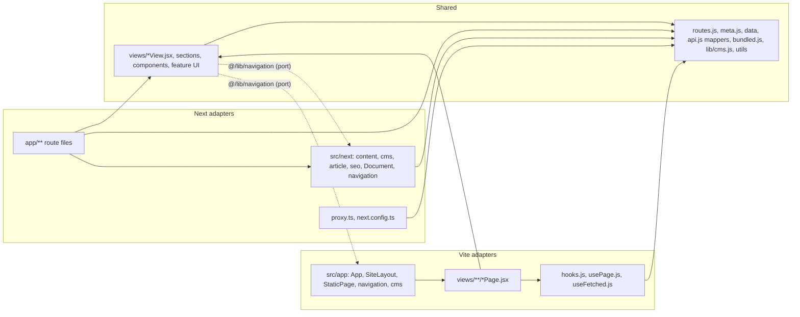

# Next.js Target Architecture: HMV Global public website

| | |
|---|---|
| Status | Revision 4, 2026-11-08. On branch `feat/nextjs-foundation`: every page, product and article in EN and VI, the CMS server layer behind `CMS_CONTENT` (off), the generated sitemap, the revalidation endpoint, layer rules enforced and tested, TypeScript `strict`, and CI. Not merged; production runs Vite. Images, fonts, the remaining SEO surfaces and cutover are still designs. Review: §16. |
| Pinned versions | `next` **16.4.5** (exact), `react`/`react-dom` 19.3.0 (installed), Tailwind 4.3.3, TypeScript 5.9.3 (new `.ts`/`.tsx` files only) |
| API source | The documentation shipped with the pinned version, `node_modules/next/dist/docs/` (the same pages as `https://nextjs.org/docs/…`). Citations below give the path under `01-app/`. Where the docs were ambiguous, the 16.4.5 source code was read and is cited instead. |
| Related | [Audit](NEXTJS_MIGRATION_AUDIT.md) · [SEO, i18n and GEO spec](SEO_I18N_GEO_SPEC.md) · [URL matrix](URL_MIGRATION_MATRIX.md) · [Roadmap](MIGRATION_ROADMAP.md) |

## 1. Principles

1. **One public frontend.** The migration happens in place in `HMV_landingpage`. Until cutover, production keeps serving the Vite build and the Next.js build only goes to preview deployments.
2. **Vite keeps working until cutover, and that is tested.** Every change to a shared module must leave the Vite builds (`build`, `build:cms`), unit tests, lint and both Vite Playwright suites green, with the same results as on `main` (§12).
3. **Shared code is framework-neutral.** Presentational components and pure data functions are shared. Anything that touches a router, head tags, `import.meta.env`, `localStorage` or a CMS transport sits in a framework adapter. Shared modules never import from a Next-only module.
4. **Reuse before rewrite.** Same markup, CSS classes, copy and behavior. A component is split only where a framework boundary runs through it.
5. **CMS boundaries unchanged.** The site uses public `GET /api/v1/public/*` endpoints only. No CMS, schema, auth or contract change.

## 2. Layers and dependency direction

Three layers and one port. The only allowed directions are **shared → shared**, **vite → shared** and **next → shared**. `npm run lint` runs `scripts/check-boundaries.js`, which resolves every import (relative and `@/`) and fails on:

- an import from a layer that the importer may not use (shared → vite or next, vite → next, next → vite);
- a framework package in the wrong layer (`next`, `next/*`, `server-only` outside Next; `react-router-dom`, `react-helmet-async` outside Vite);
- shared code that reads `import.meta.env` or `process.env`, or calls `fetch`. Configuration and I/O belong to adapters, which pass data or a transport in.

`scripts/check-boundaries.test.js` (part of `npm test`) pins these rules: every allowed direction passes and every forbidden one fails, for each import form in use (alias `@/`, relative with and without extension, re-export, `export *`, side-effect import, dynamic `import()`, `import type`, multi-line import), plus framework packages, `fetch` and environment reads.

| Layer | Files (the checker's list is authoritative) | May import |
|---|---|---|
| **Shared** | Everything in `src/` not listed below: views (`*View.jsx`, sections), `components/`, `features/` UI, and the pure modules `i18n/routes.js`, `views/meta.js`, `data/*`, `features/*/api.js` (CMS mappers), `features/*/bundled.js`, `lib/cms.js` (CMS contract), `lib/safeUrl.js`, `lib/utils.js` | Shared modules and the port `@/lib/navigation` |
| **Vite** (deleted at cleanup) | `src/main.jsx`, `src/app/**` (`App`, `SiteLayout`, `StaticPage`, `navigation.jsx`, `cms.js`), `src/views/**/*Page.jsx`, `components/common/PageMeta.jsx`, `i18n/LanguageContext.jsx`, `LangQueryBootstrap.jsx`, `LegacyLocaleRedirect.jsx`, `lib/useFetched.js`, `features/articles/hooks.js`, `features/pages/usePage.js` | Shared, plus React Router, Helmet, `import.meta.env`, the browser CMS transport |
| **Next** | `app/**`, `src/next/**`, `proxy.ts`, `next.config.ts` | Shared, plus `next/*`, `server-only`, the server CMS transport (CMS PR) |
| **Port** `@/lib/navigation` | No file at that path. Vite maps it to `src/app/navigation.jsx` (`vite.config.js` alias); Next maps it to `src/next/navigation.jsx` (`tsconfig.json` `paths`, honored by Turbopack). | n/a |



The dotted edges are resolved by the build, not by the source: shared code names the port, never an implementation.

### 2.1 Rules that keep Vite intact

| Rule | Why | How it is enforced |
|---|---|---|
| Shared code reaches routing only through the port `@/lib/navigation` | `next/link` cannot run under Vite, and React Router cannot run under Next | `scripts/check-boundaries.js` (part of `npm run lint`) |
| Helpers that Vite needs are never placed in a `server-only` module | Importing one from the browser bundle breaks it | Pure modules may not import `server-only` (checker); only Next adapters do |
| Head tags are applied by adapters, not by shared components | Vite uses `PageMeta` and Helmet on the client; Next uses route `metadata` on the server | `DetailLayout` renders no head tags. Each Vite page adapter renders `PageMeta`; Next routes export `metadata`. |
| Titles and descriptions are computed once | Both builds must emit the same values | `src/views/meta.js`, used by `PageMeta` (Vite) and `pageMetadata()` (Next). Views framed by `DetailLayout` use the same values as their heading. |
| Image imports go through `assetSrc()` | Vite returns a URL string, Next returns `{ src, width, height }` | Applied once in each data module (`hmv.js`, `productPhotos.js`, `logisticsServices.js`, `operationalLogistics.js`, `logisticsActivities.js`) and in the components that import images directly |
| Data comes in as props | Vite fetches with hooks in the browser; Next fetches on the server | Views take `state`/`articles`/`product` props; no view calls a data hook |
| Tailwind scans code, not docs | Prose in `docs/` was adding utilities to the Vite CSS | `@source not "../../docs"` in `index.css`. Vite CSS is byte-identical to `main` (§12). |
| Tailwind runs once per build | Vite would also pick up `postcss.config.mjs` | `vite.config.js` sets `css.postcss: {}`. The PostCSS config is for Next only. |

## 3. Folder structure (as implemented)

```
HMV_landingpage/
  app/                                     # Next.js routes only
    (en)/layout.tsx                        # root layout #1: <Document lang="en">
    (en)/(site)/layout.tsx                 # <SiteShell lang="en"> (nav, main, footer, chat)
    (en)/(site)/page.tsx                   # /
    (en)/(site)/<page>/page.tsx            # /about, /supply-chain, /trade-solutions, /activities, /contact, /insights,
                                           # /regulations, /logistics, /packaging-logistics
    (en)/(site)/products/[id]/page.tsx     # /products/<id>
    (en)/blog/[slug]/page.tsx              # /blog/<slug> (frames its own SiteShell, as on Vite)
    (vi)/layout.tsx                        # root layout #2: <Document lang="vi">
    (vi)/vi/(site)/…                       # the same pages under /vi, products at /vi/san-pham/[slug]
    (vi)/vi/tin-tuc/[slug]/page.tsx        # /vi/tin-tuc/<slug>
    global-not-found.tsx                   # the 404 for every URL without a route (§10)
  proxy.ts                                 # legacy URL forms only: one 308 to the final URL (§4.3)
  next.config.ts                           # noindex fail-safe, collection redirects (from routes.js), globalNotFound
  postcss.config.mjs                       # Tailwind for the Next build only
  deploy/vercel.next.json                  # Vercel config for Next previews (§15)
  scripts/check-boundaries.js              # layer rules (§2), run by `npm run lint`
  src/
    views/                                 # renamed from src/pages; Next.js would otherwise fail the build (audit F-22)
      meta.js                              # shared titles, descriptions and article structured data
      <route>/<Name>View.jsx               # shared page body
      <route>/<Name>Page.jsx               # Vite adapter, where the page needs more than StaticPage
      <route>/ImagePreview.jsx, article/BackButton.jsx   # client islands
    app/                                   # Vite application: App, SiteLayout, StaticPage, navigation, cms
    next/                                  # Next adapters: seo.ts, Document.tsx, article.tsx, navigation.jsx
    i18n/routes.js                         # shared URL contract (SEO spec §2)
    lib/cms.js                             # CMS contract: URL builder and errors (no transport)
    features/, components/, data/, styles/
```

A ported route has a shared `<Name>View.jsx`, a Vite adapter (`StaticPage` in `App.jsx` when only the language matters, otherwise `<Name>Page.jsx`), and two Next route files.

## 4. Routing

### 4.1 Two root layouts

`app/(en)` and `app/(vi)` are route groups, each with its own root layout. That gives `<html lang>` in the server HTML, English URLs without a prefix (no rewrite or proxy on normal requests), and Vietnamese segment names that are plain folders. Docs (`03-api-reference/03-file-conventions/route-groups.md`):

- "Navigating between routes that use different root layouts… will trigger a full page reload". Switching language therefore reloads the page.
- "Routes in different groups should not resolve to the same URL path."
- With multiple root layouts and no top-level layout, the home route must sit inside a group (`(en)/(site)/page.tsx`).

The nested `(site)` group carries the chrome, so the 404 (§10) can stay chrome-less, as it is on the Vite site.

### 4.2 Route files

A route file only picks the locale and params, loads data, exports metadata, renders a shared view, and redirects or 404s when that is the route's job. The EN and VI twins differ only in the locale literal (and the param name for products); Next needs one file per URL.

```tsx
// app/(vi)/vi/(site)/supply-chain/page.tsx
export const metadata = pageMetadata({ lang: 'vi', path: '/supply-chain', ...supplyChainMeta('vi') });
export default function Page() {
  return <SupplyChainView lang="vi" />;
}

// app/(vi)/vi/tin-tuc/[slug]/page.tsx: resolution, metadata and JSX live once, in src/next/article.tsx
export const dynamicParams = false;
export const generateStaticParams = articleSlugs;
export const generateMetadata = async ({ params }: Props) => articleMetadata('vi', (await params).slug);
export default async function Page({ params }: Props) {
  return <ArticlePage lang="vi" slug={(await params).slug} />;
}
```

Products and bundled articles use `generateStaticParams` with `dynamicParams = false`, so every page is prerendered and unknown slugs get the server-rendered global 404 (§10).

### 4.3 Redirects, verified on 16.4.5

| Mechanism | Used for | Facts from the docs that shaped the design |
|---|---|---|
| Built-in trailing-slash redirect | `/about/` → `/about` | Default `trailingSlash: false` redirects to the URL without the slash (`05-config/01-next-config-js/trailingSlash.md`). It runs **before** the proxy, so `/en/about/` takes two hops. |
| `next.config` `redirects()` | Collection URLs in every locale (`INDEX_ALIASES` × `LOCALES` from `routes.js`: `/products`, `/vi/san-pham`, `/blog`, `/vi/tin-tuc`), each with `missing: [{ type: 'query', key: 'lang' }]` | "any query values provided in the request will be passed through to the redirect destination" (`redirects.md`). A config redirect therefore cannot drop `?lang=`, which is why `?lang` goes to the proxy. `permanent: true` = 308, which "instructs clients/search engines to cache the redirect forever". |
| `proxy.ts` (formerly middleware; "The `middleware` file convention is deprecated and has been renamed to `proxy`", `03-file-conventions/proxy.md`) | Legacy forms: any URL with `?lang=`, `/en`, `/en/*`, `/index.html`, `/vi/products/*`, `/vi/blog/*` | Runs only for the `matcher` entries, which must be literals ("The `matcher` values need to be constants so they can be statically analyzed"); the target comes from the shared `legacyRedirect()`. Drift between the matcher and the contract is caught by the redirect-chain E2E tests. Normal requests never invoke it. |
| `permanentRedirect()` in route code | An article slug of the other locale (`/blog/xuat-khau-chanh-day-eu`) | Both locales' slugs are in `generateStaticParams`, so the redirect is prerendered: **observed 308 with `Location`** on `next start`. "When used in a streaming context, this will insert a meta tag" (`04-functions/permanentRedirect.md`), so there is no `loading.tsx` or Suspense above it. |

Complete rules and chains: [URL matrix §3–4](URL_MIGRATION_MATRIX.md).

## 5. Server and client components

No page or layout is a client component. `'use client'` is set only on these modules (Vite ignores the directive):

| Kind | Modules | Why client |
|---|---|---|
| Islands created for the migration | `components/common/Lightbox.jsx` (`Lightbox`, `ZoomTrigger`, `LightboxPreview`), `views/logistics/ImagePreview.jsx`, `views/packaging-logistics/ImagePreview.jsx`, `views/article/BackButton.jsx`, `features/inquiries/ContactForm.jsx` | Photo preview state, history navigation, `useSearchParams`. The Logistics and Packaging pages used to hold the preview state at page level; they are now server components. |
| Interactive sections | `views/activities/Activities.jsx` (carousel), `views/supply-chain/Operations.jsx` (tabs), `views/home/sections/ValueJourney.jsx`, `LivingLogistics.jsx`, `features/inquiries/TradeRfq.jsx` | Local state and effects of the section itself |
| Chrome | `Navigation`, `LanguageSwitcher`, `SupportChatWidget` | Menu state, dropdown, chat |
| Port | `src/next/navigation.jsx` | `usePathname`, `useRouter` |

Migration debt (kept for parity, not the target): `Navigation` is one 620-line client component for seven open/close toggles (target: a server-rendered menu with small client toggles); `CinematicHero` is a client component for one scroll button (target: a `ScrollCue` island); `SupportChatWidget` loads on every page (lazy-load in PR-08).

Client components are still rendered on the server: the server HTML of every page contains its full text (Next E2E, and the Vite/Next parity check in §12). Radix dropdown content renders only when open, so the switcher options are not in the server HTML; crawlers use the head `hreflang` links ([SEO spec §3](SEO_I18N_GEO_SPEC.md#3-language-switcher-behavior)).

### 5.1 Contact form and `useSearchParams`

The docs say: "During production builds, a static page that calls `useSearchParams` from a Client Component must be wrapped in a `Suspense` boundary, otherwise the build fails" (`04-functions/use-search-params.md`). The implemented split has no conditional hook:

```jsx
// features/inquiries/ContactForm.jsx ('use client')
export function ContactForm({ lang, product = '' }) { /* form, unchanged markup */ }
export function ContactFormFromUrl({ lang }) {
  const params = useSearchParams();                    // unconditional, top level
  return <ContactForm lang={lang} product={params.get('product') || ''} />;
}
// features/inquiries/Contact.jsx (shared section): only in full mode
<Suspense fallback={<ContactForm lang={lang} />}><ContactFormFromUrl lang={lang} /></Suspense>
```

In Next, the static page contains the fallback form and the client renders the preselected one. In Vite, the React Router hook does not suspend.

## 6. Navigation port

`@/lib/navigation` has the same API in both implementations:

| Export | Next (`src/next/navigation.jsx`) | Vite (`src/app/navigation.jsx`) | After cleanup |
|---|---|---|---|
| `Link` (`to` = English key path) | `next/link` with `localizePath(to, locale of the current page)` | React Router `Link` (URLs are locale-free) | Stays: components keep writing key paths |
| `useRoutePath()` | English key path of `usePathname()`, for active states | `useLocation().pathname` | Stays |
| `useSearchParams()` | re-export of `next/navigation` | React Router, first tuple element | Deleted: import from `next/navigation` |
| `useLanguageSwitch()` | `{ lang, hrefFor, select }`: `hrefFor` is the real URL of the same page in that language; `select` adds the current query (minus `lang`) and `#hash` and navigates | `{ lang, hrefFor: () => undefined, select: setLang }` (a re-render, as today) | Stays, without the Vite branch in `LanguageSwitcher` |
| `useGoBack()` | `router.back()`, or the localized home page when there is no history | `navigate(-1)`, or `/` | Stays |

## 7. Data fetching and the CMS layer

```
route (app/**)  →  content loader (src/next/content.ts)  →  mapper (features/*/api.js)  →  transport (src/next/cms.ts)
                    picks bundled or CMS, applies            validates DTOs, maps to the       HTTP, origin, cache and
                    CMS_BLOCKED_SLUGS                        view shape, resolves slugs        revalidation, timeout, errors
```

| Piece | Owns | Never touches |
|---|---|---|
| **Transport** `cmsGet` (`src/next/cms.ts`, `server-only`) | The origin (`CMS_API_ORIGIN`); `fetch(…, { next: { revalidate: 300, tags: ['cms'] } })`; `Cache-Control: no-cache` on the request, so an HTTP cache in front of the CMS revalidates with it; an 8 s timeout; errors normalized to `{ status }` (HTTP status, 503 unreachable, 504 timeout, 0 malformed); no logging | Response shapes |
| **Mappers** `fetchPage`, `fetchArticles`, `fetchArticleIndex`, `resolveArticle` (`features/*/api.js`) | DTO validation, the view shape (`Article`, with `alternates` per locale), pairing translations by their shared CMS id, cross-locale slug resolution. JSDoc types (`Article`, `ArticleResolution`) are the contract for any consumer. | `fetch`, Next.js, React, environment, cache APIs, `server-only` (checker-enforced; the URL checks moved to `lib/safeUrl.js` so mappers no longer import the React renderer) |
| **Content loader** (`src/next/content.ts`, `server-only`) | `CMS_CONTENT` (bundled or CMS), `CMS_BLOCKED_SLUGS`, list sizes | Rendering |
| **Routes** | Locale, params, metadata, the shared view; 404 and 308 | Data sources |
| **Browser transport** (`src/app/cms.js`, Vite only) | The same contract for the Vite CMS mode | n/a; deleted at cleanup |

No repository, service or factory layer: two transports and four mapper functions do not need one. The mappers return plain data with no React or Next.js dependency, so a future module (a trade tool, a contextual assistant, a feed) can call them with any transport. That is the only provision made for such modules.

Caching rules (no Cache Components): "By default, `fetch` requests are not cached" (`02-guides/caching-without-cache-components.md`). `next.revalidate` opts a fetch in, and "Only responses with a `200` HTTP status code are stored" (`04-functions/fetch.md`): a 404 is never cached as data, only as the rendered page. With `CMS_CONTENT` off, the routes make no fetch and are fully static (○ or ● in the build output).

## 8. Rendering strategy

| Page type | Recommended | Reason |
|---|---|---|
| Homepage | SSG; ISR (300 s) once the CMS is on | Static except the 3 latest EcoNews cards |
| About | SSG with bundled copy; ISR with the CMS on | CMS-managed and rarely changed |
| Supply Chain | SSG | Bundled data; no CMS API exists |
| Product listing (`/trade-solutions`) | SSG | Bundled; ISR once a commodities API exists |
| Product detail | SSG, `generateStaticParams`, `dynamicParams = false` ("Dynamic route segments not included in `generateStaticParams` will return a 404", `dynamicParams.md`) | 6 fixed products |
| Articles listing | SSG; ISR with the CMS on | Up to 100 items |
| Article detail | Known slugs of both locales prerendered (`generateStaticParams` from the index); `dynamicParams = true`, so a new CMS article renders on its first request and is then cached (ISR) | Segment config must be a literal, so one setting serves both modes |
| Sitemap (`app/sitemap.ts`) | Static; ISR with the CMS on | Built from the route contract and the article index, so it lists exactly what the pages' `hreflang` lists |
| Contact / RFQ | SSG shell plus client form island | No server data; `mailto:` only |
| Logistics, Packaging, Activities, Regulations | SSG | Bundled |

SSR is not used: there is no personalization or authentication, and CMS drafts are not public. ISR trade-offs are in §9.

## 9. CMS freshness, load and takedown (applies from the CMS PR)

### 9.1 What server fetching does and does not solve

| Concern | Effect of server fetching plus ISR |
|---|---|
| Browser CORS and the same-origin rewrite | **Removed.** The browser never calls the CMS. |
| Load from normal traffic | **Reduced.** At most one CMS request per cache entry per revalidation window, instead of one per visitor. |
| Rate limiting of the public API | **Not solved.** (1) The CMS public API stays reachable directly at its own origin by anyone. (2) Through the site, every never-seen article slug renders on demand and can cost up to two CMS calls (own locale, then the other locale for `alternates`); a bot enumerating random slugs therefore reaches the CMS. A CMS-side or CDN rate limit is still required (CMS/infra owner). The site adds: slug syntax validation before fetching, an optional Vercel WAF rate-limit rule on article routes (owner), and cached 404 results (verify in the CMS PR). |

### 9.2 Freshness: 300 s is a revalidation interval, not an update SLA

The docs describe stale-while-revalidate (`02-guides/incremental-static-regeneration.md`): after the window, "the next request will still return the cached (now stale) page", and regeneration runs in the background. Consequences:

| Layer | Behavior |
|---|---|
| CMS HTTP caching | The CMS sends `public, max-age=60, stale-while-revalidate=300` on every public response, **404s included**. Any HTTP cache between the site's functions and the CMS (for example a CDN in front of the CMS) can add up to about 360 s. |
| Next data cache, per fetch | Each distinct request is its own entry with its own 300 s window: the article detail, the home list (`pageSize=3`), the insights list (`pageSize=100`), the sitemap pages, About per locale. They expire and refresh **independently**, so for a while a new article can be in the list but not the sitemap, or an unpublished one can stay in the list after its detail returns 404. |
| Page (ISR) | Revalidates at the lowest fetch window, on the **first request after** the window. That request still gets the stale page; the next one gets the new page once regeneration succeeds. A page with no traffic stays stale until someone requests it. |
| Errors | "If an error is thrown while attempting to revalidate data, the last successfully generated data will continue to be served from the cache. On the next subsequent request, Next.js will retry" (ISR guide). During a CMS outage, neither updates nor takedowns reach the site. |

Expectation to communicate to editors: with traffic, typically within about 5–11 minutes, with no guaranteed upper bound. For anything urgent, use §9.3.

### 9.3 Emergency takedown (implemented; tested against the mock CMS)

1. **CMS:** archive or unpublish the article or page locale (an editor with the right permission). The public API then returns 404, after any HTTP cache in front of the CMS.
2. **Site:** an operator calls `POST /api/revalidate` with the header `x-revalidate-secret: <REVALIDATE_SECRET>`. It calls `revalidateTag('cms', { expire: 0 })`, which expires every cached CMS response at once (one tag: the content is small, and an operator never has to know which tags a page used). The docs: "`{ expire: 0 }`: Stale content is never served, so the next request is a blocking revalidate" (`04-functions/revalidateTag.md`). The endpoint answers 401 without the right secret, compares in constant time, logs nothing, and is disabled when the variable is unset.
3. **Verify:** the article URL returns 404, and `/insights`, `/vi/insights` and `/sitemap.xml` no longer contain it.
4. **If the CMS cannot unpublish it, or is unreachable:** set `CMS_BLOCKED_SLUGS` (comma-separated slugs, per locale; list both translations' slugs to remove both) and redeploy (Vercel environment changes need a new deployment). A blocked slug is a 404 under every URL form that resolves to it (`/blog/…`, `/vi/tin-tuc/…`, the other locale's route, `/tin-tuc/…`; legacy aliases redirect to one of those), and it leaves the lists, the alternates and the sitemap. Do not use rollback for this: older deployments contain the same content.
5. **Images:** CMS media files are served by the CMS media host. Optimized copies (`next/image`, after the images PR) are cached for `images.minimumCacheTTL`. Removal = delete the media in the CMS, revalidate, then purge the image cache in Vercel (owner), or wait for the TTL.

What the CMS suite (`tests/next-cms/`) shows: a cached article is served without a CMS request after it is unpublished; a missing or wrong secret changes nothing; after the endpoint call the detail is 404, the lists and the sitemap drop it, and the refetch reached the CMS despite its `max-age=60` answer, with `Cache-Control: no-cache` on the request; the other translation stays. Not automated: a CDN in front of the CMS that ignores `no-cache` would still serve its copy for up to `max-age` + `stale-while-revalidate` (about 360 s); that is the CMS/infra owner's configuration.

## 10. Errors, loading and 404 (verified on the branch)

| Situation | Implementation | Observed (`next start`, 16.4.5) |
|---|---|---|
| URL without a route (EN or VI), including an unknown product id (`dynamicParams = false`) | `app/global-not-found.tsx` with `experimental.globalNotFound: true`. Same markup as the Vite 404 (`NotFoundView`: chrome-less, "Page not found", link to `/`, English for every URL as on Vite today). | **404**, static, fully server-rendered, `<html lang="en">`, `noindex` (meta tag and header) |
| `notFound()` thrown inside a page: an unknown, unpublished or blocked article slug (`dynamicParams = true`) | No custom file works: a `not-found.tsx` in the group or in the article segment is not used | **Status 404 and noindex are correct; the server HTML is an error shell (`<html id="__next_error__">`) and the browser renders Next.js's default 404 ("404: This page could not be found.", chrome-less).** The cause is that there is no single layout above both root layouts (`03-file-conventions/not-found.md`: `global-not-found.js` is "useful when… your app has multiple root layouts"). Decision D-17. |
| A redirect rendered by an ISR page (the other locale's article slug) | `permanentRedirect()` | 308. **On the first request after the page is regenerated (cache MISS), Next.js 16.4.5 sends the `Location` header twice, with the same value**: the render sets it and the cached entry's headers are appended (`next/dist/build/templates/app-page-runtime.js`). Later hits send it once. Browsers accept identical duplicates; recheck on every Next.js upgrade and on the Vercel preview (OA-1), whose cache path differs. |
| CMS error on a URL never generated | `error.tsx` (client, localized) | 5xx: crawlers retry, and a live page is not deindexed |
| Streaming | No `loading.tsx` and no Suspense above `notFound()` or redirects: "After streaming starts, the status code remains `200`" (`not-found.md`) | n/a |

Consequences for later PRs:

- Products use `dynamicParams = false`, so an unknown id never matches a route and gets the server-rendered global 404.
- Article routes need `dynamicParams = true` (new CMS slugs), so an unknown article slug, bundled mode included, is a 404 with Next.js's default body rendered on the client. This is acceptable for indexing, because search engines act on the status (D-17).
- `globalNotFound` is **experimental** in 16.4.5 (the build prints "Experiments (use with caution)"). If it is removed or changes, the fallback is catch-all routes plus segment `not-found.tsx`: status stays correct and the body becomes client-rendered.

## 11. Images, fonts and CSS

- **Images:** the static import extensions accepted by 16.4.5 are `jpg, jpeg, png, webp, avif, ico, svg` (`node_modules/next/dist/build/webpack/loaders/utils.js`). The two `.jfif` files were renamed to `.jpg` (JFIF is JPEG, so the pixels are identical). Plain `` with `assetSrc()` is used until the images PR switches to `next/image` ("If the image is statically imported, Next.js will automatically determine the intrinsic width and height", `01-getting-started/12-images.md`).
- **CSS:** `index.css` then `hmv.css` are imported in `src/next/Document.tsx`, the same order as `src/main.jsx`. Tailwind for Next uses `@tailwindcss/postcss`, as documented in `01-getting-started/11-css.md`.
- **Fonts:** the Google Fonts `<link>` from `index.html` is kept in `Document.tsx` for parity. `next/font` comes in the images/CWV PR: `subsets` must cover Vietnamese, which needs checking per family (`02-components/font.md`).

## 12. Coexistence evidence (branch `feat/nextjs-foundation`)

The only place these numbers are kept; the other documents link here.

| Check | `main` (baseline) | Branch (revision 4) |
|---|---|---|
| `npm run build` (Vite) JS / CSS | 620.42 kB / 156.50 kB `index-CUg3tHd_.css` | 624.49 kB / **156.50 kB, same file hash**; `dist/sitemap.xml` byte-identical to `main`'s |
| `npm run build:cms` | passes | passes |
| `npm test` (Vitest) | 49/49 | 66/66: +9 layer checker, +4 route contract, +1 product slugs, +3 CMS mappers |
| `npm run lint` | 0 errors, 9 warnings | 0 errors, 9 warnings; layer boundaries OK |
| `tsc --noEmit`, `next build` type check | n/a | pass with `strict: true` |
| Playwright, Vite | 89 passed, 3 skipped | 111 passed, 7 skipped |
| Playwright, CMS mode (Vite) | 35 passed, 1 skipped | 35 passed, 1 skipped |
| `next build` | n/a | 48 prerendered pages (static and SSG), proxy, sitemap, two route handlers, global 404 |
| Playwright, Next (`tests/next/`) | n/a | 193 passed, 3 skipped (switcher cases on mobile): all 38 indexable URLs, 404s, 28 redirect chains, sitemap = page `hreflang`, noindex everywhere, Article JSON-LD, islands, switcher |
| Playwright, Next with the CMS (`tests/next-cms/`, mock CMS) | n/a | 12 passed: About and lists from the CMS, not-published states, alternates, M-52 to M-57, takedown, blocked slugs, 5xx on an uncached failure, no browser request to the CMS, no secret or origin in client bundles or server output |
| GitHub CI (`ci.yml`, Linux) | n/a | green on `3591cc3` (Actions run 42400650297), the same totals as above for lint, layers and all four Playwright suites |

## 13. Environment variables and security

| Variable | Scope | Purpose |
|---|---|---|
| `SITE_INDEXABLE` | Next, build and runtime | Only the exact value `true` removes the noindex header and meta. **Unset everywhere until cutover.** At cutover it is set on the production project's Production environment only. A fail-safe default: forgetting it leaves a site unindexed, never a test site indexed (§15.2). |
| `CMS_CONTENT` | Next server, build and regeneration | `true` reads About, EcoNews and the sitemap's articles from the CMS. Off in this phase. |
| `CMS_API_ORIGIN` | Next server | Read only by the transport. Never `NEXT_PUBLIC_*`; the CMS suite checks client bundles for it. |
| `CMS_MEDIA_HOST` | `next.config` | `images.remotePatterns` allow-list (images PR) |
| `REVALIDATE_SECRET` | Next server | Required by `POST /api/revalidate`; unset disables it (§9.3). Never logged; the CMS suite checks bundles and server output for it. |
| `CMS_BLOCKED_SLUGS` | Next server | Comma-separated slugs answered with 404 everywhere (§9.3) |
| `VITE_CMS_CONTENT` | Vite (`.env.cms`) | Unchanged until cleanup |

## 14. TypeScript and linting

- `next build` type-checks. Next added its standard entries to `tsconfig.json` (`plugins`, `isolatedModules`, `incremental`, `.next/types` includes); Vite ignores them.
- `strict: true`, with `allowJs: true` and `checkJs: false`: every `.ts`/`.tsx` file is strict, and JSX legacy files are not checked. Turning it on found four real errors, all in the product routes (a possibly undefined product, an untyped slug map), fixed with `notFound()` narrowing and one JSDoc type. JS modules that TS files import are typed by inference plus a few JSDoc annotations (`SiteShell`, `Button`, `ArticleView`, the mapper result types).
- ESLint ignores `.next/`. The Fast Refresh rule is switched off only for the two navigation adapters, which export hooks next to `Link` by design.
- `agentRules: false` in `next.config.ts`. Otherwise `next dev` writes a managed block into `AGENTS.md` (`05-config/01-next-config-js/agentRules.md`); that file is owned by the team.

## 15. Deployment

### 15.1 What exists today (observed 2026-11-07)

- One Vercel project (`hmv-landingpage`) with Git integration. Every push to a non-`main` branch creates a **Preview** deployment; merges to `main` deploy **Production** (GitHub deployment history).
- Preview URLs answer `302` to Vercel SSO (Vercel Authentication) with `X-Robots-Tag: noindex`. Vercel's documentation does not mention that header, so it is treated as observed behavior, not a guarantee.
- `https://hmv-landingpage.vercel.app/` serves the production build publicly (200, no noindex), duplicating `www`. This is an existing issue for the owner (audit F-33).
- GitHub Actions: `ci.yml` on PRs into `main` and pushes to `feat/nextjs-**` (lint and layers, unit, builds, all Playwright suites; read-only, no secrets, no deployment); `next-preview.yml` on `feat/nextjs-**`, skipped until `NEXT_PREVIEW_ENABLED=true` (§15.2); `sonarqube.yml` on `main` pushes and PRs into `main`.

### 15.2 Next.js preview configuration

The Next build must never read the root `vercel.json`, because its SPA rewrite sends every path to `/index.html`. Vercel does not document how `vercel.json` rewrites combine with a Next.js deployment.

| Item | Setting |
|---|---|
| Project | A **separate, temporary** Vercel project (for example `hmv-landingpage-next`) created with `vercel project add` (CLI, alias of `create`), **not** imported from Git. Docs: "The first deployment of a new project is always a production deployment… even when you import a Git repository in the dashboard" (`vercel.com/docs/deployments/environments`). |
| Protection, set before the first deployment | Deployment Protection → **All Deployments** (Vercel Authentication): "all URLs are protected, including your production domain… and generated URLs", available on all plans (`vercel.com/docs/deployment-protection`). This covers the project's first deployment, which is a production one, and its `*.vercel.app` domains. |
| Config file | `deploy/vercel.next.json`: framework `nextjs`, no rewrites, `git.deploymentEnabled: false`, `X-Robots-Tag: noindex, nofollow` on every path. It is passed with the CLI global option `--local-config` ("set the path to a local `vercel.json` file"; listed for `vercel build` and `vercel deploy`). |
| Build and deploy | `.github/workflows/next-preview.yml` with `vercel pull`, then `vercel build --local-config deploy/vercel.next.json`, then a guard that fails if any route in `.vercel/output/config.json` targets `/index.html`, then `vercel deploy --prebuilt --local-config …` (never `--prod`), then the preview acceptance tests. Linking uses `VERCEL_ORG_ID` and `VERCEL_PROJECT_ID` ("to skip project linking", `vercel.com/docs/cli/global-options`). Vercel CLI pinned to 65.2.0. |
| Noindex, defense in depth | (1) Vercel Authentication; (2) the platform header from `deploy/vercel.next.json`; (3) the app's fail-safe `X-Robots-Tag` header and `<meta name="robots">` unless `SITE_INDEXABLE=true`. **robots.txt is not used for this:** `Disallow` stops crawling, not indexing, and would hide the noindex from crawlers. `VERCEL_ENV` is not relied on. |
| Status | The workflow is **not yet executed**: it needs the owner setup in the [roadmap](MIGRATION_ROADMAP.md#62-nextjs-preview-owner-setup-oa-1). Until `NEXT_PREVIEW_ENABLED=true` is set, it is skipped. |

### 15.3 Cutover and rollback

Cutover switches the existing production project to the Next.js framework preset and removes the SPA rewrite in the same PR. Rollback is Vercel Instant Rollback to the last Vite deployment. The temporary Next project is deleted after cutover. Rollback limits and preconditions: [roadmap §8](MIGRATION_ROADMAP.md#8-rollback-contract).

## 16. Architecture review (revision 3)

### 16.1 Migration-only abstractions

Each one exists because the two builds differ. `grep -rn MIGRATION-ONLY` lists them in code.

| Abstraction | Coupling it removes | Why the framework API is not used directly | After cleanup (PR-12) |
|---|---|---|---|
| Port `@/lib/navigation` (`src/app/navigation.jsx`, `src/next/navigation.jsx`) | Shared components on a router | Each build has its own router and URL scheme (locale-free vs localized) | Vite implementation deleted; the Next one stays as the localized `Link`, `useRoutePath`, `useLanguageSwitch`, `useGoBack`; the `useSearchParams` re-export goes |
| `StaticPage` (`src/app`) | Six identical Vite page adapters | Vite head tags need a component per page | Deleted |
| Browser transport (`src/app/cms.js`) | Mappers on browser `fetch` | Vite has no server | Deleted; the server transport remains |
| `assetSrc()` | Shared data on the bundler's image import shape | Vite gives a URL string, Next an object | Deleted with `next/image` (PR-08) |
| `resolveBundledArticle()` | Vite article URLs on per-locale slugs | Locale-free URLs need one canonical slug | Deleted |
| `LegacyLocaleRedirect` mapping of the new Vietnamese URLs | Rollback target on the Next URL scheme | A rollback serves the Vite build | Deleted with the Vite app |
| Vite rules in `scripts/check-boundaries.js` | n/a | n/a | Simplified to the Next rules |

Abstractions that **stay** after cleanup, because they are the target design: the URL contract (`src/i18n/routes.js`), titles and descriptions (`src/views/meta.js`), `pageMetadata()` (`src/next/seo.ts`), the CMS contract and mappers (`src/lib/cms.js`, `features/*/api.js`), `Lightbox` and the other islands.

### 16.2 Single sources of truth

| Fact | Defined once in | Derived by |
|---|---|---|
| Locales, page key paths, Vietnamese product slugs, collection aliases, article slug pairing | `src/i18n/routes.js` (article pairs read from `data/articles.js`) | Links (`Link`), switcher (`switchHref`), canonical and `hreflang` (`pageMetadata`), proxy (`legacyRedirect`), config redirects (`INDEX_ALIASES` × `LOCALES`), product and article `generateStaticParams`, the Vite rollback mapping, the Next E2E URL list. The sitemap (PR-07) will use the same functions. |
| Titles and descriptions | `src/views/meta.js` | Vite `PageMeta`, Next `metadata`, `DetailLayout` headings |
| Absolute URLs and the `hreflang` set | `alternateUrls()` in `src/next/seo.ts`, on top of `localizePath()` | Page metadata and `app/sitemap.ts` |
| Which source serves content, and what is blocked | `src/next/content.ts` | Every Next route, the sitemap, `/tin-tuc/[slug]` |
| CMS response shape | `features/*/api.js` | Both transports |
| Layer membership | `scripts/check-boundaries.js` | `npm run lint`, CI |

Framework-materialized exception: the proxy `matcher` must be a literal, so it repeats the legacy prefixes. The redirect-chain E2E tests fail if it drifts from `legacyRedirect()`.

### 16.3 Findings

**P0: architecture.** Both fixed in this revision.

| ID | Finding | Change |
|---|---|---|
| A-1 | Shared components imported `@/lib/navigation`, which **was** the Next implementation file (`next/link`): shared → Next in the source graph | The path is now a port with no file; each build maps it (Vite alias, tsconfig `paths`). The implementations live in their adapter folders. |
| A-2 | The layer rules were only documented | `scripts/check-boundaries.js`, run by `npm run lint` and CI. It found the six unported sections importing React Router; they are ported now and the check passes. |

**P1: maintainability.** All fixed except where noted.

| ID | Finding | Change |
|---|---|---|
| M-1 | CMS mappers imported the browser transport, so a server transport could not reuse them | Transport passed as an argument; `lib/cms.js` keeps only the contract; the browser transport moved to the Vite layer |
| M-2 | `next.config.ts` hand-copied the collection URLs | Derived from `INDEX_ALIASES` × `LOCALES` |
| M-3 | `routes.js` re-implemented the article slug lookup | Uses `findArticle()` from `data/articles.js` |
| M-4 | Logistics and Packaging held preview state at page level, which would have made both whole pages client components | Server views plus the `Lightbox` island |
| M-5 | EN and VI article routes would duplicate resolution, metadata and JSX | One Next module, `src/next/article.tsx`; route files only bind the locale |
| M-6 | Page sizes duplicated between Vite adapters and Next routes (`3`, `100`) | `LATEST_ARTICLES`, `INSIGHTS_PAGE_SIZE` exported by the shared views |
| M-7 | Product ids in `PRODUCT_SLUG_VI` could drift from `data/hmv.js` | Unit test: same ids, unique slugs |
| M-8 | Next code (`app/`, `proxy.ts`, `next.config.ts`) was outside `sonar.sources` | Added |
| M-9 | `ViteDetailLayout` and the six one-line Vite page modules | Deleted (`StaticPage`) |

**P2: later, only where it does not raise migration risk.**

| ID | Finding | When |
|---|---|---|
| L-1 | `Navigation.jsx` (620 lines, cognitive complexity 42): seven booleans and repeated submenu blocks; a data-driven menu would remove most of it | With the server-rendered menu, after cutover |
| L-2 | `SupportChatWidget.jsx` (545 lines, complexity 28) mixes UI, canned answers and claims under D-12 review | After D-12; lazy-load in PR-08 |
| L-3 | `LogisticsView` (complexity 37), `SupplyChainPillars` (39), `PackagingView` (20): long content components with inline EN/VI ternaries | Move copy to data modules after cutover |
| L-4 | Nested ternaries in moved code (`toDoc` in `bundled.js`, `ContactForm` autocomplete, `ArticleView` states, `Activities`, `Operations`) | When those files change for other reasons |
| L-5 | `LanguageSwitcher` keeps an unused-in-Next `currentLang` prop and exports `LANGUAGES` only for itself | PR-12 (the Vite branch goes too) |
| L-6 | `operationalPhotos` in `data/operationalLogistics.js` is unused | Any time |
| L-7 | Twin route files: Next needs one file per URL; each binds a locale literal | Accepted |
| L-8 | `LegacyLocaleRedirect` and `LangQueryBootstrap` repeat small URL logic | Deleted with the Vite app |

### 16.4 Automated reviewers

Workflow: no draft PRs during development; the branch CI and the architecture review are the gates. To merge into `main`, a normal PR is opened so SonarQube Cloud and CodeRabbit run as the final automated review; findings with real value are fixed before merging (D-18).

Until then, the SonarJS recommended rules (`eslint-plugin-sonarjs` 3.0.5, installed outside the repository) are run locally as an approximation. Revision 3: one issue in new code, fixed (S5852 in the Next `Link`). Revision 4: six in new code, fixed: S5852 in the checker's import regex (rewritten without ambiguous quantifiers), cognitive complexity in `findViolations` (helper extracted), S4721 in `tests/next-cms/serve.js` (the Next.js CLI now runs through `process.execPath`, no shell), a nested ternary in the mock, and a clear-text URL used only as a parsing base in a test. Kept on purpose: the control-character regex in `lib/safeUrl.js` (moved unchanged from `RichText.js`; matching control characters is the point). The remaining 17 are in existing or moved code (L-1 to L-4). Copy-paste detection was not run locally.

Dispositions for automated suggestions:

- Accept fixes that remove a real defect, duplication or security hotspot.
- Reject suggestions that add layers or abstractions to satisfy a metric, or that refactor existing large components before cutover (L-1 to L-4). Record the reason on the PR.
- Coverage on new code: `app/` and `src/next/` are exercised by the Next E2E suite, which SonarQube does not import. If the gate fails on coverage there, the remedy is unit tests for logic, not excluding files.

### 16.5 Revision 4 (CMS server layer)

No new P0. Dependency graph: one more Next module chain, `route → src/next/content.ts → features/*/api.js → src/next/cms.ts` (§7); shared code is unchanged in direction.

| ID | Kind | Finding | Change |
|---|---|---|---|
| R4-1 | P1 | The article mapper imported `isSafeSrc` from the React renderer (`RichText.js`), so mappers depended on React | URL checks moved to `src/lib/safeUrl.js`, used by both |
| R4-2 | P1 | The lock file written by npm on Windows lacked two optional dependencies, so `npm ci` failed on Linux (found by CI; would have broken `sonarqube.yml` on `main`) | Lock fixed and verified on Linux; `docs/architecture.md` says to regenerate it on Linux |
| R4-3 | P1 | `strict` was off; turning it on found a possibly undefined product in both product routes | `strict: true`; `notFound()` narrowing |
| R4-4 | P1 | The layer checker was untested | `scripts/check-boundaries.test.js` |
| R4-5 | P1 | Status numbers were copied between documents and drifted (53/53 vs 54/54; §15.1 said no workflow ran on branches) | Numbers only in §12; §15.1 and the roadmap corrected |
| R4-6 | Upstream | Duplicate identical `Location` on the first response after an ISR redirect page regenerates (Next.js 16.4.5) | Documented in §10; recheck on upgrade and on the Vercel preview |
| R4-7 | Upstream | Unknown article slugs show Next.js's default 404 body, rendered on the client; status and noindex are correct | D-17; a custom `not-found.tsx` is not used under two root layouts |
| R4-8 | P2 | Next.js writes the root as `B` in head tags and `B/` in the sitemap | The same URL (RFC 3986); tests compare normalized URLs |
| R4-9 | P2 | The language switcher on a CMS article links to the same slug in the other locale; the route answers one 308 to the alternate (M-54) | Accepted; a direct link would need the alternates passed to the switcher |
| R4-10 | P2 | `vite` (dev server) no longer serves `/sitemap.xml`; `vite build` and `vite preview` do | Accepted until cleanup |

What is already reusable by future modules (a trade tool, a contextual assistant), without building for them:

- the transport contract (`get(path, params)`, `{ status }` errors) and the server transport;
- the mappers and their JSDoc result types, which return plain data with no React or Next.js dependency;
- the article index (translations paired by CMS id) and the URL model (`localizePath`, `alternateUrls`).

Not built, because nothing needs it yet: a repository or service layer, per-item cache tags, a CMS webhook client, a plain-text or search projection of articles.
